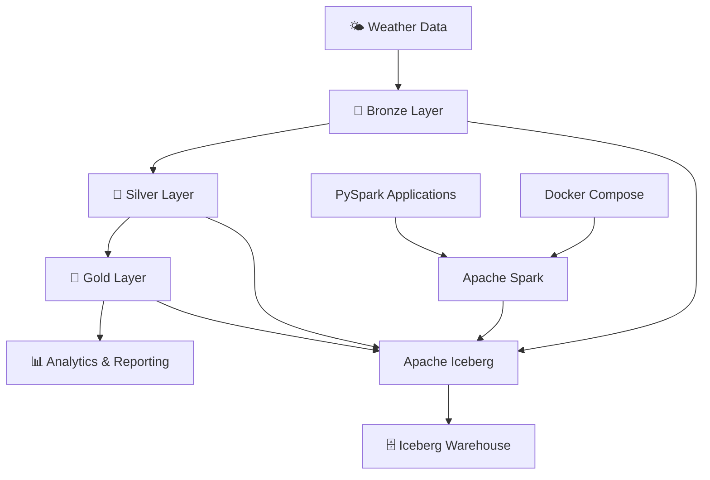

# 🌦️ Weather Data Engineering Pipeline
### Building a Lakehouse with Apache Spark, PySpark & Apache Iceberg

<p align="center">
  
  
  
  
  
  
</p>

<p align="center">
  <strong>An end-to-end data engineering project exploring modern Lakehouse architecture, distributed data processing, and reliable data management using Apache Iceberg.</strong>
</p>

---

## 📌 Table of Contents
- [🌟 Project Overview](#-project-overview)
- [🎯 Project Objectives](#-project-objectives)
- [🏗️ Architecture](#️-architecture)
- [🛠️ Technology Stack](#️-technology-stack)
- [📂 Project Structure](#-project-structure)
- [⚙️ Prerequisites](#️-prerequisites)
- [🚀 Getting Started](#-getting-started)
- [⚡ Running the Pipeline](#-running-the-pipeline)
- [🖥️ Monitoring](#️-monitoring)
- [🧠 Key Concepts](#-key-concepts)
- [🔮 Future Enhancements](#-future-enhancements)
- [🤝 Contributing](#-contributing)
- [📜 License](#-license)

---

## 🌟 Project Overview

The **Weather Data Engineering Pipeline** is a hands-on project designed to explore how modern data engineering technologies can be combined to build a scalable and reliable Lakehouse platform.

This project is based on the YouTube Tutorial: [End-to-End Weather Data Pipeline | Apache Iceberg Project for Data Engineers](https://www.youtube.com/watch?v=T_6gpuG4PQY).

The project uses **Apache Spark** and **PySpark** for distributed data processing and **Apache Iceberg** as the table format for managing analytical datasets.

It also introduces the **Medallion Architecture**, a layered approach to organizing data into Bronze, Silver, and Gold layers.

The infrastructure runs locally using **Docker Compose**, making it easier to experiment with Spark and Iceberg without requiring a cloud environment.

### 💡 Why this project?

Traditional data lake implementations can become difficult to manage when datasets require updates, historical tracking, schema evolution, and reliable analytical processing.

Apache Iceberg addresses these challenges by providing capabilities such as:
* ACID transactions.
* Schema evolution.
* Partition evolution.
* Snapshot-based data management.
* Time travel.
* Efficient metadata management.

This project provides a practical environment to understand these capabilities through weather data processing.

---

## 🎯 Project Objectives

The primary objectives are:
* Understand modern Lakehouse architecture.
* Implement distributed data processing using PySpark.
* Explore Apache Iceberg table management.
* Understand Bronze, Silver, and Gold data organization.
* Work with Spark running in a distributed environment.
* Learn how Iceberg integrates with Apache Spark.
* Explore reliable data updates and upsert operations.
* Understand how Docker simplifies local data engineering infrastructure.

---

## 🏗️ Architecture

The project follows the principles of Medallion Architecture.

### Data Processing Flow



### 🥉 Bronze Layer – Raw Data
The Bronze layer represents the raw-data ingestion stage. Typical responsibilities include:
* Ingesting weather observations.
* Preserving incoming records.
* Maintaining source-level information.
* Retaining raw data for downstream processing.

### 🥈 Silver Layer – Cleaned and Refined Data
The Silver layer represents the data refinement stage. Typical responsibilities include:
* Cleaning and transforming weather observations.
* Handling duplicate records.
* Managing corrected observations.
* Performing upsert operations.
* Maintaining consistent analytical records.

### 🥇 Gold Layer – Business-Ready Data
The Gold layer represents the analytical stage. Typical responsibilities include:
* Aggregating weather observations.
* Creating analytical datasets.
* Preparing data for reporting and visualization.
* Supporting downstream analytical workloads.

> **Note:** These descriptions explain the intended Medallion Architecture. Refer to the individual application scripts for the currently implemented transformations.

---

## 🛠️ Technology Stack

| Technology | Version | Purpose |
| :--- | :--- | :--- |
| **Python** | 3.12+ | Programming language |
| **PySpark** | 3.5.1 | Distributed data processing |
| **Apache Spark** | 3.5.1 | Processing engine |
| **Apache Iceberg** | 1.9.2 | Lakehouse table format |
| **Docker** | Compose | Containerized infrastructure |
| **SQL** | Spark SQL | Data querying and transformations |

### Technology Documentation
* [Apache Spark](https://spark.apache.org/docs/latest/)
* [Apache Iceberg](https://iceberg.apache.org/docs/latest/)
* [PySpark Documentation](https://spark.apache.org/docs/latest/api/python/)
* [Docker Documentation](https://docs.docker.com/)
* [Python Documentation](https://docs.python.org/3/)

---

## 📂 Project Structure

```text
apache_iceberg_weather_data_project/
│
├── apps/                       # PySpark application scripts
├── data/                       # Data storage directory
├── iceberg-warehouse/          # Iceberg warehouse storage
├── jars/                       # Iceberg Spark runtime JARs
├── compose.yml                 # Docker Compose configuration
├── commands.txt                # Useful Spark execution commands
├── pyproject.toml              # Python project configuration
├── uv.lock                     # Dependency lock file
├── .python-version             # Python version configuration
├── .gitignore                  # Git ignore rules
├── LICENSE                     # MIT License
└── README.md                   # Project documentation
```

---

## ⚙️ Prerequisites

Before running the project, ensure you have the following installed:
* Python 3.12 or later.
* Docker Engine or Docker Desktop.
* Docker Compose.
* Git.
* Apache Iceberg Spark runtime JAR (version 1.9.2).

---

## 🚀 Getting Started

### 1. Clone the Repository
```bash
git clone https://github.com/sathyamangalamshreyas/apache_iceberg_weather_data_project.git
cd apache_iceberg_weather_data_project
```

### 2. Prepare the Required Directories
The Docker Compose configuration mounts local directories into the Spark containers. Ensure the following directories exist:

```bash
mkdir -p apps data iceberg-warehouse jars
```

### 3. Download the Apache Iceberg Runtime JAR
Download the Iceberg runtime compatible with Spark 3.5 and Scala 2.12:

```bash
curl -L \
  https://repo1.maven.org/maven2/org/apache/iceberg/iceberg-spark-runtime-3.5_2.12/1.9.2/iceberg-spark-runtime-3.5_2.12-1.9.2.jar \
  -o jars/iceberg-spark-runtime-3.5_2.12-1.9.2.jar
```

### 4. Start the Spark Infrastructure
Launch the Spark Master and Worker containers:

```bash
docker compose -f compose.yml up -d
```

Check running containers:

```bash
docker ps
```

### 5. Verify the Spark Cluster
Open the Spark Master Web UI: [http://localhost:8080](http://localhost:8080)

The Spark Worker Web UI is available at: [http://localhost:8081](http://localhost:8081)

---

## ⚡ Running the Pipeline

The repository includes Spark execution commands in `commands.txt`.

### Submit a PySpark Application

The following command runs the Silver upsert application using the configured Spark cluster and Iceberg catalog:

```bash
docker exec iceberg-spark-master \
  /opt/spark/bin/spark-submit \
  --master spark://spark-master:7077 \
  --jars /opt/iceberg-jars/iceberg-spark-runtime-3.5_2.12-1.9.2.jar \
  --conf spark.sql.extensions=org.apache.iceberg.spark.extensions.IcebergSparkSessionExtensions \
  --conf spark.sql.catalog.local=org.apache.iceberg.spark.SparkCatalog \
  --conf spark.sql.catalog.local.type=hadoop \
  --conf spark.sql.catalog.local.warehouse=/opt/iceberg/warehouse/weatherdata_project \
  --conf spark.sql.defaultCatalog=local \
  --conf spark.sql.session.timeZone=UTC \
  /opt/spark-apps/silver_upsert.py
```

### Open the Spark Worker Container
```bash
docker exec -it iceberg-spark-worker bash
```

### Start an Interactive PySpark Session
Inside the Spark Worker container:

```bash
/opt/spark/bin/pyspark \
  --master spark://spark-master:7077 \
  --jars /opt/iceberg-jars/iceberg-spark-runtime-3.5_2.12-1.9.2.jar \
  --conf spark.sql.extensions=org.apache.iceberg.spark.extensions.IcebergSparkSessionExtensions \
  --conf spark.sql.catalog.local=org.apache.iceberg.spark.SparkCatalog \
  --conf spark.sql.catalog.local.type=hadoop \
  --conf spark.sql.catalog.local.warehouse=/opt/iceberg/warehouse/weatherdata_project
```

---

## 🖥️ Monitoring

The project exposes the following web interfaces:

| Service | URL | Description |
| :--- | :--- | :--- |
| **Spark Master** | [http://localhost:8080](http://localhost:8080) | Cluster monitoring |
| **Spark Worker** | [http://localhost:8081](http://localhost:8081) | Worker monitoring |
| **Spark Application UI** | [http://localhost:4040](http://localhost:4040) | Application execution monitoring |

*The Spark Application UI is available while an application is running.*

---

## 🧠 Key Concepts

This project provides an opportunity to explore several important data engineering concepts:

1. **Apache Iceberg Tables**: Understand how Iceberg manages large analytical datasets through metadata files, manifests, and snapshots.
2. **ACID Transactions**: Explore reliable table modifications and transactional consistency.
3. **Upsert Operations**: Understand how `MERGE INTO` can be used to insert new records and update existing observations.
4. **Medallion Architecture**: Learn how data moves through Bronze, Silver, and Gold layers to support increasingly refined analytical workloads.
5. **Distributed Processing**: Understand how Spark distributes data processing workloads across a Master and Worker architecture.
6. **Dockerized Infrastructure**: Learn how to deploy and manage a local data engineering environment using Docker Compose.

---

## 🔮 Future Enhancements

Potential extensions to this project include:
* Integrate a real-time weather API.
* Automate Bronze, Silver, and Gold processing.
* Implement comprehensive data quality checks.
* Add Iceberg snapshot history exploration.
* Demonstrate time travel queries.
* Implement schema evolution scenarios.
* Add workflow orchestration using Apache Airflow.
* Integrate Apache Superset or Power BI for visualization.
* Add automated testing and pipeline monitoring.

---

## 🤝 Contributing

Contributions, suggestions, and improvements are welcome!

If you would like to contribute:
1. Fork this repository.
2. Create a feature branch.
3. Make your changes.
4. Submit a pull request.

---

## 📜 License

This project is licensed under the MIT License. See the `LICENSE` file for more details.

---

## 👨‍💻 Author

**Shreyas**  
* GitHub: [@sathyamangalamshreyas](https://github.com/sathyamangalamshreyas)  
* Project Repository: [apache_iceberg_weather_data_project](https://github.com/sathyamangalamshreyas/apache_iceberg_weather_data_project)

<p align="center">
<strong>🌦️ Turning Weather Data into Insights with Modern Lakehouse Technology 🚀</strong>
</p>
